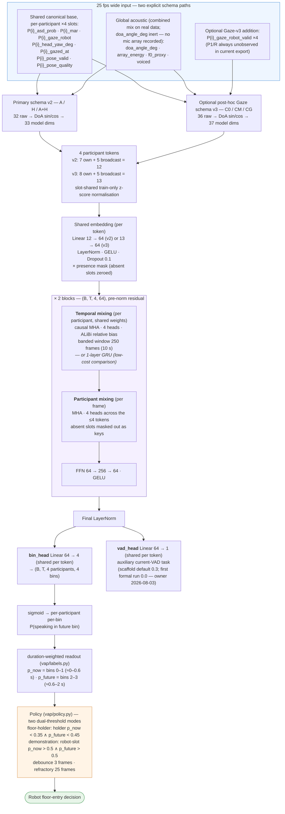
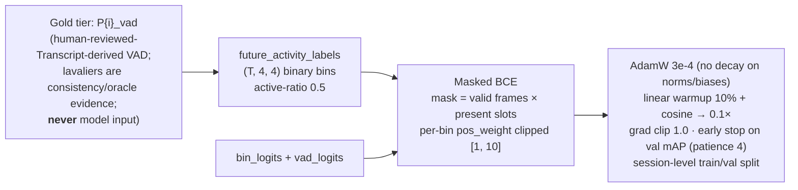

# Model Architecture — MultipartyVAP

Participant-structured causal sequence model predicting each participant's
**future voice activity** over discretised bins (0.2 / 0.6 / 1.2 / 2.0 s),
following the VAP literature (Ekstedt & Skantze) scaled down to this project's
data budget (~130k params). Each participant is a token; all
participant-processing weights are shared, so predictions are **equivariant to
slot permutation** and the same weights serve 3- and 4-party sessions.

Source: `src/hri_turn_taking/vap/model.py` · defaults from `VAPModelConfig`.

## Input-schema paths

| Path | Conditions and status | Interpretation |
|---|---|---|
| Primary schema v2 | 32 raw columns → 33 transformed dimensions; A, H and A+H use 7 own + 5 global features per token (`Linear 12→64`) | frozen deadline path; inactive canonical columns are masked before fitting the normaliser |
| Optional Gaze schema v3 | adds four `P{i}_gaze_robot_valid` columns: 36 raw → 37 transformed dimensions; 8 own + 5 global per token (`Linear 13→64`) | post-hoc only; C0 disables value+validity, CM enables validity only, CG enables validity+value; `CG-CM` isolates content and `CM-C0` measures missingness/observability |

The exact-eight v3 run (64,299 rows, four groups, seed 13,
`max_epochs=15`) completed 12/12 condition/fold units. The independently
audited aggregate SHA-256 is
`0b4f2c5e3deafafa0d23cdb4822f328d95af5c0788ba662cd9c04d7414955cea`.
Pooled frame mAP was 0.2717/0.2461/0.2843 for C0/CM/CG;
`CG-CM=+0.0381` was positive in all four folds and `CM-C0=-0.0256`.
P1/R has no direct Gaze observation. Exact upstream regeneration and
implementation-level counterfactual causality are unverified, so this path is
single-seed post-hoc exploratory evidence, not a replacement for v2, a
production input, or evidence that changes the H1/H2 verdicts.

## Training (vap/trainer.py)

## Key design notes

| Choice | Rationale |
|---|---|
| Participant tokens + shared weights | Slot permutation equivariance (unit-tested); ~4× supervision per parameter vs. slot-specific weights; native 3-/4-party transfer |
| Cross-participant attention | Turn-taking cues are relational (who is gazed at, who competes for the floor); absent slots masked out as keys so padding can never leak into present participants (unit-tested) |
| ALiBi relative bias, banded window | No absolute-position train/inference mismatch (windows trained at positions 0–249, sessions run to ~4500); heads span short/long memory; chunked inference with `n_layers × window` left context is **exactly** a full pass (unit-tested) |
| Independent per-bin BCE | Multi-party simplification of the 256-class joint VAP state space (joint space explodes to 2^12+ for 3–4 people) |
| Duration-weighted p_now/p_future | Readout = expected fraction of the interval containing speech; a plain bin mean over-weights the short near bins |
| Two heads | Auxiliary current-VAD head optionally regularises the shared encoder; disabled (weight 0.0) in the first formal run per the 2026-08-03 owner decision |
| DoA as sin/cos | A DoA angle wraps at 0/360°; z-scoring a wrapped angle breaks at the seam. On real data `doa_angle_deg` is an **inert constant** (no mic array was recorded; user decision 2026-07-10) — kept only so the synthetic/ablation layout is unchanged; constants z-score to zero |
| Per-frame `pose_valid` flag | Real tracking has dropouts; a zeroed `head_yaw_deg` must be distinguishable from a genuine 0° (facing the robot). Slot `present` stays static — a tracker gap must not fake a participant leaving (Codex R1.1). Validity propagates through the yaw geometry: non-R needs R observed; R needs ≥ 2 valid centroid members (a 1-member "centroid" would degenerate into addressee semantics — Codex R1.2-5 ruling) |
| Continuous `pose_quality` channel | The relaxed R rule makes yaw quality graded (centroid from the valid member subset); the valid-member fraction is a robot-observable quality signal in its own right, kept separate from the binary flag rather than overloaded into it (Codex R1.2-5) |
| Floor-holder gating in policy | Max-over-all-humans gating never fires; original Skantze & Irfan (HRI 2025) semantics gate on the previous speaker yielding |
| Demonstration-driven entry mode | The corpus' robot slot is a human role-player, so its own prediction reads "a human in my position would speak now" — floor entry distilled from demonstration; requiring p_now ∧ p_future skips predicted backchannels; scored against the demonstrator's real entries (recall / false entries / lead) |
| Group-aware splits | One recording group produces several scenario videos; a per-video split would leak speaker identities. Real grouping uses only gated provenance `group_id`; `group_delimiter` is a synthetic-only convenience, never a real-data heuristic. |
| Event metrics pooled across sessions | Per-session macro-averaging is noisy at tens of events per session; includes shift/hold, shift-prediction, overlap-resolution (backchannel vs. competitive, RQ3) and robot-entry (demonstration agreement) |

## Deployment notes (Phase 2 — constraints recorded, not yet implemented)

The training corpus contains a **human role-playing the robot** (receptionist
scenarios, natural behaviour, standing in Furhat's future position; see
AGENTS.md §8), so the robot occupies a regular participant slot end-to-end.
On the physical robot the slot's features come from Furhat self-state:

| Robot-slot feature | Deployment source |
|---|---|
| `asd_prob` | TTS active (exact 0/1) |
| gaze | commanded gaze target |
| `head_yaw_deg` | commanded head pose |
| `mar` | lip-sync animation parameter |
| `gazed_at` | aggregate of the others' gaze-at-robot scores |
| `pose_valid` | 1 while self-state is available (effectively always); for human slots: Furhat's face-tracking "face visible" flag |
| `pose_quality` | robot slot: fraction of interlocutors currently face-tracked (mirrors the training-time valid-member fraction); human slots: 1 while that person's face is tracked |

- **Feature-substitution shift**: training-side robot-slot features are noisy
  camera estimates of the role-player; deployment-side they are exact
  self-state. Quantify offline by substituting the mapped features on
  validation sessions before trusting the online loop.
- **Self-voice**: Furhat's TTS reaches the deployment microphone and pollutes
  `array_energy` / `f0_proxy` (combined-mix-trained), and degrades ASD's
  audio-visual matching for every face exactly when barge-in detection matters
  most (during robot speech). Mitigate with echo cancellation fed the TTS
  reference signal, or gate the global acoustic features and suspend
  floor-entry decisions while the robot speaks. The corpus does contain human
  speech *from the robot position*, so "speech from that direction" is
  in-distribution; the residual risk is TTS/loudspeaker acoustics, not
  geometry.
- **DoA stays disabled at deployment** (Codex R1.4-5): the real-data model is
  trained with `doa_angle_deg` as an inert constant (no mic array was
  recorded), so feeding a *live*, varying DoA at deployment would be
  out-of-distribution input, not a trained capability. The default deployed
  configuration must pin the DoA input to the same constant; only a separate
  mic-array-ablation checkpoint actually trained on real array data may
  consume a live DoA.
- **Latency accounting**: Furhat TTS startup (200–400 ms) sits on top of any
  policy trigger; report policy trigger time and TTS startup separately, with
  the demonstrator's own floor-entry latency as the human ceiling. Feature
  resampling adds **zero algorithmic lookahead** (strict past-only zero-order
  hold in intake; a frame may hold an observation up to `max_gap_s` = 0.2 s
  old — bounded staleness, not added pipeline latency, and the deployed
  perception stack reproduces exactly this behaviour).
- **Demonstration-driven entry (implemented 2026-07-05)**: `DemonstrationPolicy`
  enters when the *robot slot's own* p_now and p_future both exceed their
  thresholds — the demonstration-distilled "a human in my position would speak
  now"; requiring a sustained turn skips predicted backchannels. The offline
  demo scores both modes and the reactive baseline against the demonstrator's
  real entries (recall / false entries / lead time). Which mode drives the
  live robot is still open; both stay within the dual-threshold family
  (AGENTS.md §4.6). A "no one else about to enter" safety conjunct remains a
  possible refinement.

Reference numbers on synthetic data (12×180 s, 20 epochs, CPU): see
`AGENTS.md` §6 (kept in one place to avoid drift).
