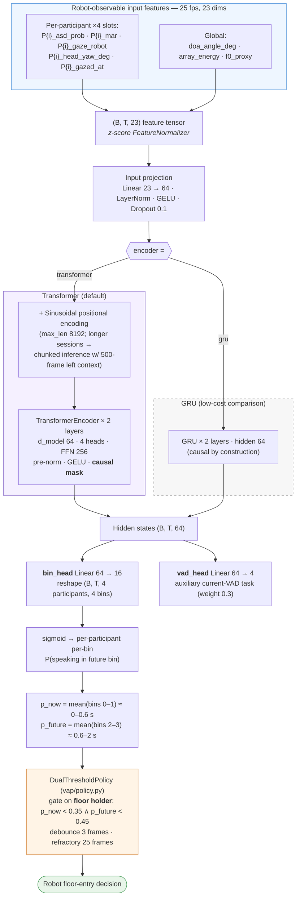
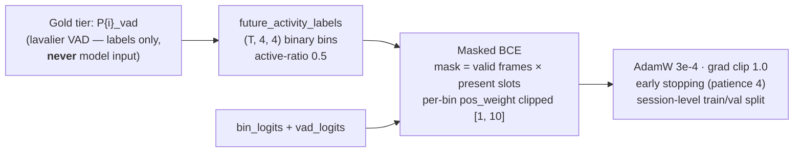

# Model Architecture — MultipartyVAP

Causal sequence model predicting each participant's **future voice activity**
over discretised bins (0.2 / 0.6 / 1.2 / 2.0 s), following the VAP literature
(Ekstedt & Skantze) scaled down to this project's data budget (~100k params).

Source: `src/hri_turn_taking/vap/model.py` · defaults from `VAPModelConfig`.

## Training (vap/trainer.py)

## Key design notes

| Choice | Rationale |
|---|---|
| Independent per-bin BCE | Multi-party simplification of the 256-class joint VAP state space (joint space explodes to 2^12+ for 3–4 people) |
| Causal mask / GRU | No future leakage; verified by a unit test perturbing future frames |
| Two heads | Auxiliary current-VAD head regularises the shared encoder |
| Feature-agnostic input | Model only sees a `(B, T, features)` tensor — real extracted features drop in by changing `input_dim` |
| Floor-holder gating in policy | Max-over-all-humans gating never fires; original Skantze & Irfan (HRI 2025) semantics gate on the previous speaker yielding |

Reference numbers on synthetic data (12×180 s, 20 epochs, CPU): frame mAP ≈ 0.88,
shift/hold AP ≈ 0.68, shift-prediction AP ≈ 0.72; predictive policy enters gaps
in 0.16–0.58 s while the 1.5 s silence baseline never enters.
